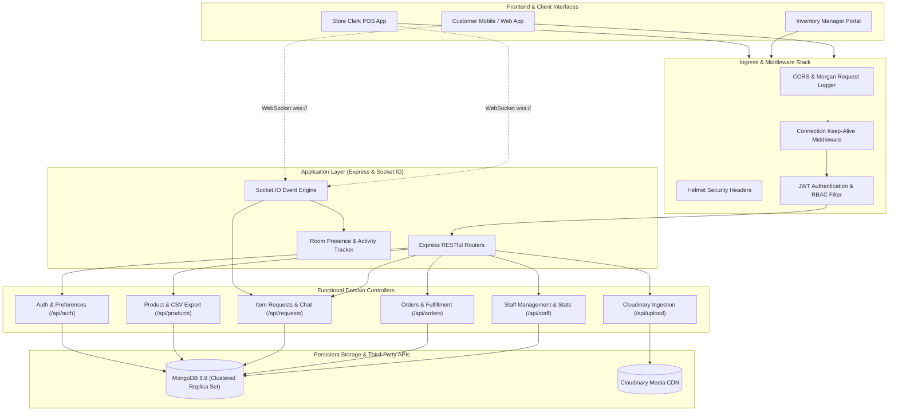
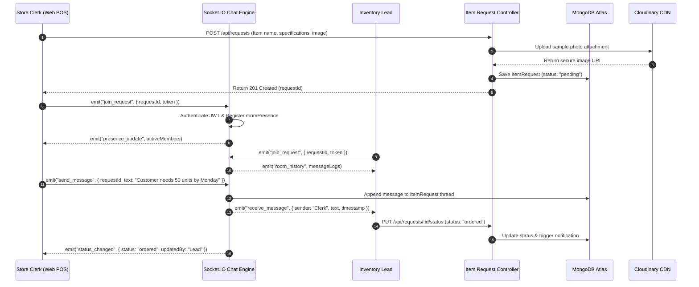

# Retail OS — Stateless Real-Time Store & Inventory Backend

[](https://opensource.org/licenses/MIT)
[](https://nodejs.org/)
[](https://expressjs.com/)
[](https://socket.io/)
[](https://www.mongodb.com/)
[](https://cloudinary.com/)
[](https://github.com/helmetjs/helmet)
[](https://vercel.com/)

---

## 📋 Executive Summary & Problem Solved

Modern retail operations struggle with fragmented, laggy communication between store clerks on the shop floor, procurement leads managing replenishment, warehouse associates picking orders, and store managers analyzing sales metrics. Traditional retail ERP systems are monolithic, expensive, and lack real-time reactivity:

1. **Information Silos Between Front & Back Office**: When a customer requests an out-of-stock item, the store clerk records it on paper or sends an untracked instant message, losing procurement context and status visibility.
2. **Delayed Inventory Synchronization**: Bulk inventory edits and orders handled across multiple terminals cause race conditions and out-of-sync stock tallies.
3. **Rigid Role Permissions**: Store hierarchies require fine-grained access control (e.g., distinguishing between a warehouse picker, a store cashier, and an inventory supervisor).
4. **Heavyweight Infrastructure Lock-In**: Many backends cannot scale dynamically between cheap serverless edge endpoints and dedicated real-time WebSocket clusters.

**Retail OS (`STORE_HANDLING`)** is an enterprise-ready, stateless, secure backend designed to power high-throughput retail workflows. Featuring a dual HTTP REST and **Socket.IO event engine**, it delivers instant bidirectional messaging in dedicated request rooms, robust **7-tier Role-Based Access Control (RBAC)**, Cloudinary asset streaming, CSV catalog exports, and seamless automated database reconnection.

---

## ✨ Key Features

- ⚡ **Real-Time Socket.IO Request Rooms**: Live dispatch rooms (`request_<id>`) for instant customer-to-staff procurement messaging, live typing indicators, and room presence tracking (`roomPresence`).
- 🔐 **Granular 7-Tier RBAC**: Native permission gates supporting `super_admin`, `admin`, `inventory_lead`, `inventory_manager`, `store_clerk`, `staff`, and `warehouse_associate`.
- 📦 **Dynamic Product & Inventory Management**: Stock tracking, batch quantity adjustments, low-stock threshold triggers, and bulk catalog CSV streaming.
- 📋 **Procurement Item Request Pipeline**: Full lifecycle tracking for customer custom requests (`pending` ➔ `reviewing` ➔ `ordered` ➔ `received` ➔ `rejected`) with audit logs.
- 🖼️ **Cloudinary Media Pipeline**: Direct-to-cloud asset ingestion for product display images, user profile avatars, and chat screenshot attachments via Multer memory buffers.
- 📑 **Customer Quicklists & Restock Alerts**: Personal item bookmarks with automated notification toggles when depleted inventory is replenished.
- 📊 **Real-Time Store Telemetry**: Aggregated business metrics, revenue summaries, pending order totals, and fulfillment statistics.
- 🌐 **Dual Serverless & Cluster Architecture**: Instant zero-cold-start performance on Vercel Edge (`api/index.js`) and long-running clustered Node.js instances with WebSocket persistence (`server.js`).

---

## 🏗️ System Architecture



---

## 🔄 Real-Time Item Procurement Workflow



---

## 🛠️ Tech Stack

| Component | Technology | Version | Purpose |
| :--- | :--- | :--- | :--- |
| **Runtime Engine** | Node.js | `>= 18.0.0` | Non-blocking asynchronous I/O backend |
| **HTTP Framework** | Express.js | `^4.21.2` | RESTful routing and middleware handling |
| **Real-Time Engine** | Socket.IO | `^4.8.3` | Low-latency WebSockets with HTTP polling fallback |
| **Database & ODM** | MongoDB / Mongoose | `^8.9.5` | Document persistence, schema validation, compound indexing |
| **Cloud Storage** | Cloudinary | `^2.5.1` | Automated image compression, transformations, and asset CDN |
| **Security Headers** | Helmet | `^8.0.0` | Mitigates XSS, clickjacking, and MIME sniffing attacks |
| **Token Verification**| JSON Web Token | `^9.0.2` | Cryptographic JWT payload validation for REST and Sockets |
| **Password Hashing** | `bcryptjs` | `^2.4.3` | Blowfish cipher adaptive password hashing |
| **Multipart Parsing**| `multer` | `^1.4.5-lts.1`| In-memory buffer ingestion for image uploads |
| **Server Logging** | `morgan` | `^1.10.0` | HTTP request telemetry and diagnostics |

---

## 📂 Repository Directory Structure

```text
STORE_HANDLING/
├── api/
│   └── index.js                      # Vercel serverless HTTP gateway entry point
├── config/
│   ├── cloudinary.js                 # Cloudinary v2 SDK credentials & configuration
│   └── db.js                         # Mongoose connection manager with retry logic
├── controllers/
│   ├── addressController.js          # Customer delivery addresses & primary selection
│   ├── authController.js             # User login, registration, demo-login, profile
│   ├── itemRequestController.js      # Procurement item request lifecycle & message threads
│   ├── orderController.js            # Customer orders, status changes, order items
│   ├── productController.js          # Catalog management, stock updates, CSV export
│   ├── quicklistController.js        # Bookmarked products & restock alerts
│   ├── staffController.js            # Staff roster, role assignment, verification
│   ├── statsController.js            # Business analytics and inventory totals
│   └── uploadController.js           # Cloudinary buffer upload handlers
├── middleware/
│   ├── auth.js                       # JWT auth, role validation (requireRole, requireVerifiedMember)
│   └── errorHandler.js               # Centralized exception logging and HTTP response parser
├── models/
│   ├── Address.js                    # Shipping and store physical address schema
│   ├── ItemRequest.js                # Custom sourcing requests with embedded chat history
│   ├── Order.js                      # Customer retail transactions and status milestones
│   ├── Product.js                    # Inventory SKU, category, price, stock, images
│   ├── Quicklist.js                  # User wishlist and restock notification flags
│   ├── Staff.js                      # Staff operational roles and verification status
│   └── User.js                       # Base user model with bcrypt authentication methods
├── routes/
│   ├── addressRoutes.js              # /api/addresses endpoints
│   ├── authRoutes.js                 # /api/auth endpoints
│   ├── itemRequestRoutes.js          # /api/requests endpoints
│   ├── orderRoutes.js                # /api/orders endpoints
│   ├── productRoutes.js              # /api/products endpoints
│   ├── quicklistRoutes.js            # /api/quicklist endpoints
│   ├── staffRoutes.js                # /api/staff endpoints
│   ├── statsRoutes.js                # /api/stats endpoints
│   └── uploadRoutes.js               # /api/upload endpoints
├── scripts/
│   ├── prune.js                      # Database maintenance & orphaned record cleanup
│   ├── seed.js                       # Mock catalog and staff bootstrap seeder
│   └── update_admin.js               # CLI utility to elevate an account to super_admin
├── sockets/
│   └── chatSocket.js                 # Real-time WebSocket connection, auth & presence logic
├── .env.example                      # Sanitized environment variable specifications
├── .gitignore                        # Git ignore patterns
├── package.json                      # NPM package definition and execution scripts
├── server.js                         # Main HTTP & Socket.IO clustered production server
└── vercel.json                       # Serverless routing rules for Vercel edge deployment
```

---

## ⚙️ Local Setup & Installation

### Prerequisites
- **Node.js**: v18.x or v20.x LTS installed
- **MongoDB**: Running instance (Local or MongoDB Atlas)
- **Cloudinary Account**: Cloud Name, API Key, and API Secret

### 1. Clone & Install
```bash
# Clone the repository
git clone https://github.com/your-username/STORE_HANDLING.git
cd STORE_HANDLING

# Install required packages
npm install
```

### 2. Configure Environment Variables
Create a `.env` file in the root folder:
```bash
cp .env.example .env
```

Set the required environment keys:
```env
PORT=5000
MONGO_URI=mongodb+srv://<user>:<password>@cluster0.mongodb.net/retail_os?retryWrites=true&w=majority
JWT_SECRET=your_ultra_secure_jwt_secret_key_here

# Cloudinary Storage Configuration
CLOUDINARY_CLOUD_NAME=your_cloud_name
CLOUDINARY_API_KEY=your_api_key
CLOUDINARY_API_SECRET=your_api_secret
```

### 3. Seed Database (Optional)
```bash
# Populates sample products, categories, and default staff credentials
npm run seed
```

### 4. Start Development Server
```bash
# Start server with live nodemon reloading
npm run dev

# Or launch directly with node
npm start
```
The server will initialize on `http://localhost:5000` with WebSockets active on the same port.

---

## 📡 Complete REST API Reference

### 🔐 Authentication (`/api/auth`)

| Method | Endpoint | Description | Access Level |
| :--- | :--- | :--- | :--- |
| `POST` | `/api/auth/login` | Authenticate existing user with email and password | Public |
| `POST` | `/api/auth/register` | Register new customer or store account | Public |
| `POST` | `/api/auth/demo-login` | Instant one-click authentication for demo evaluations | Public |
| `GET` | `/api/auth/me` | Retrieve profile and assigned permissions for active session | Authenticated |
| `PATCH`| `/api/auth/preferences` | Update UI preferences (theme, notification settings) | Authenticated |
| `PUT` | `/api/auth/profile` | Update contact details, phone, and display name | Authenticated |
| `PUT` | `/api/auth/change-password` | Update current password with bcrypt verification | Authenticated |

### 📦 Product & Inventory (`/api/products`)

| Method | Endpoint | Description | Access Level |
| :--- | :--- | :--- | :--- |
| `GET` | `/api/products` | Query products with pagination, category filter, search | Public |
| `GET` | `/api/products/:id` | Fetch detailed single product record | Public |
| `GET` | `/api/products/export/csv` | Stream entire inventory catalog as formatted CSV file | Staff / Admin |
| `POST` | `/api/products` | Create new SKU with price, stock, barcode, and tags | Inventory Lead+ |
| `PUT` | `/api/products/:id` | Update complete product metadata | Inventory Lead+ |
| `PATCH`| `/api/products/:id/stock`| Increment/decrement stock quantity with audit logging | Store Clerk+ |
| `DELETE`| `/api/products/:id` | Soft or hard delete product from catalog | Inventory Lead+ |

### 📑 Procurement Item Requests (`/api/requests`)

| Method | Endpoint | Description | Access Level |
| :--- | :--- | :--- | :--- |
| `POST` | `/api/requests` | Submit customer request for an unavailable item | Verified Member |
| `GET` | `/api/requests/my` | View all procurement requests submitted by current user | Authenticated |
| `GET` | `/api/requests/:id` | Get details and message history of a specific request | Request Owner / Staff |
| `GET` | `/api/requests` | Admin dashboard listing all active procurement requests | Inventory Lead+ |
| `PUT` | `/api/requests/:id/status`| Progress request status (`reviewing`, `ordered`, etc.) | Inventory Lead+ |
| `DELETE`| `/api/requests/:id` | Cancel/archive procurement request | Admin Only |
| `POST` | `/api/requests/:id/messages`| Post a message to the request audit thread via REST | Request Owner / Staff |
| `GET` | `/api/requests/:id/messages`| Fetch chat log history for an item request | Request Owner / Staff |

### 👥 Staff & User Management (`/api/staff`)

| Method | Endpoint | Description | Access Level |
| :--- | :--- | :--- | :--- |
| `GET` | `/api/staff/stats` | Staff productivity metrics, active members, role counts | Inventory Lead+ |
| `GET` | `/api/staff` | Roster of all internal staff members | Inventory Lead+ |
| `GET` | `/api/staff/:id` | Full member details, assigned shift, activity logs | Inventory Lead+ |
| `POST` | `/api/staff` | Invite new staff member and assign initial RBAC role | Admin Only |
| `PATCH`| `/api/staff/:id` | Modify member role (`store_clerk`, `warehouse_associate`) | Admin Only |
| `PATCH`| `/api/staff/:id/verify` | Toggle verified member status | Inventory Lead+ |
| `DELETE`| `/api/staff/:id` | Revoke staff credentials and terminate account access | Admin Only |

### 📊 Orders, Quicklists & Media

| Method | Endpoint | Description | Access Level |
| :--- | :--- | :--- | :--- |
| `GET` | `/api/orders` | Query sales orders with status and date filters | Authenticated |
| `GET` | `/api/orders/:id` | Fetch itemized sales order receipt | Authenticated |
| `GET` | `/api/quicklist` | Retrieve authenticated user's bookmarked quicklist | Authenticated |
| `POST` | `/api/quicklist` | Add product to fast-reorder quicklist | Authenticated |
| `DELETE`| `/api/quicklist/:productId`| Remove item from user's quicklist | Authenticated |
| `PATCH`| `/api/quicklist/:id/notify`| Toggle back-in-stock alerts for bookmarked item | Authenticated |
| `GET` | `/api/stats/overview` | Store KPI dashboard: daily revenue, volume, top items | Inventory Lead+ |
| `POST` | `/api/upload` | Upload product imagery to Cloudinary via Multer | Inventory Lead+ |
| `POST` | `/api/upload/avatar` | Upload and crop user profile avatar | Authenticated |
| `POST` | `/api/upload/chat` | Upload screenshot attachment for item request chat | Authenticated |

---

## ⚡ WebSocket Event Specification

Connect to `ws://localhost:5000` with auth payload: `{ auth: { token: "Bearer <JWT>" } }`.

| Event Name | Direction | Payload | Description |
| :--- | :--- | :--- | :--- |
| `join_request` | Client ➔ Server | `{ requestId: string }` | Join the real-time room for a procurement request |
| `leave_request` | Client ➔ Server | `{ requestId: string }` | Leave the specific room and remove presence |
| `send_message` | Client ➔ Server | `{ requestId, text, attachmentUrl }` | Dispatch message to room participants |
| `receive_message`| Server ➔ Client | `{ _id, sender, text, timestamp }` | Delivered to all active listeners in the room |
| `typing_start` | Client ➔ Server | `{ requestId, userName }` | Signal that a participant is drafting a message |
| `typing_stop` | Client ➔ Server | `{ requestId, userName }` | Signal that typing has ceased |
| `presence_update`| Server ➔ Client | `{ requestId, activeUsers: [] }` | Broadcast current staff & customer viewer list |

---

## 🚢 Production Deployment

### Containerized Deployment (Docker)
```dockerfile
FROM node:20-alpine
WORKDIR /usr/src/app
COPY package*.json ./
RUN npm ci --only=production
COPY . .
EXPOSE 5000
CMD ["node", "server.js"]
```

### Vercel Serverless Edge
The repository includes `api/index.js` and `vercel.json` configuring rewrites. Note that when deploying on pure serverless edge runtimes, HTTP REST endpoints execute seamlessly; for full persistent WebSockets, run `server.js` on an always-on VM, AWS ECS, Railway, or Render instance.

---

## 🛡️ Security, Performance & Best Practices

- **Role-Based Token Verification**: The `requireRole` middleware inspects token claims and cross-verifies against the active database state, instantly blocking revoked staff.
- **Fail-Safe Database Reconnection**: Express request middleware actively monitors `mongoose.connection.readyState !== 1` and reconnects transparently before routing requests.
- **Buffer-Based Cloud Ingestion**: File uploads leverage Multer memory storage and pipe directly into Cloudinary streams, avoiding local disk writes and transient file storage leaks.
- **CORS & Origin Hardening**: Secure HTTP origin reflection prevents unauthorized cross-origin execution on point-of-sale terminals.

---

## 📄 License
This project is licensed under the [MIT License](LICENSE).
